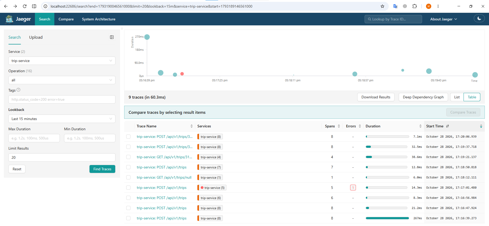
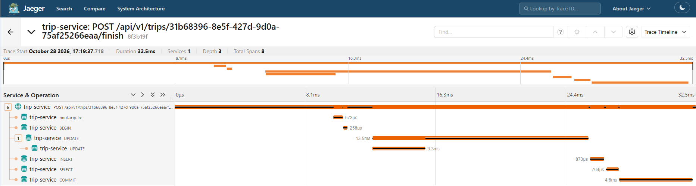
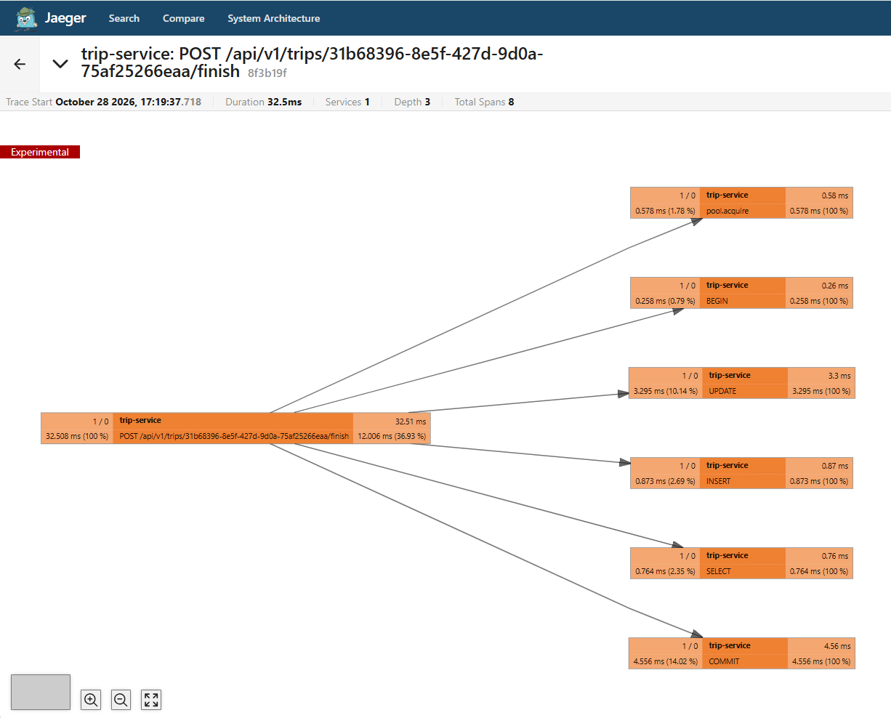
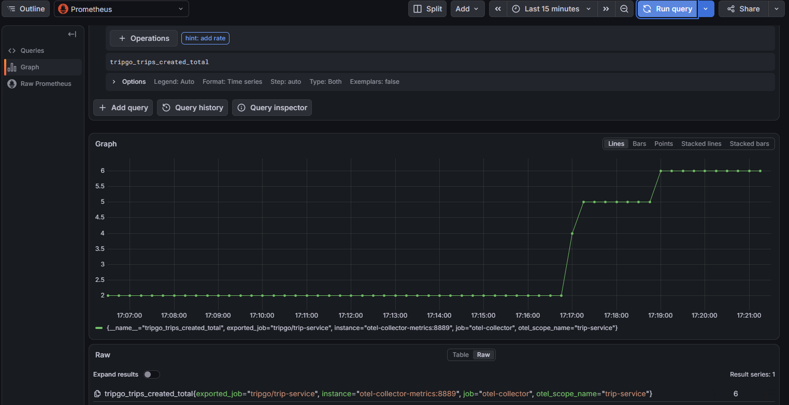
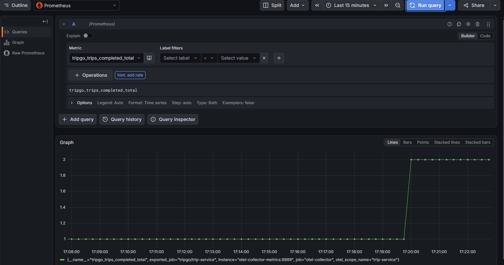

# Лабораторная работа 2

## Зависимости

- tripgoctl: ```curl --proto '=https' --proto-redir '=https' --tlsv1.2 -fsSL https://github.com/course-go-autumn-2026/course-infra/releases/latest/download/install-tripgoctl | sh```
- make + компиляторы C++ для работы тестов (в пакете уже есть make): ```sudo apt update && sudo apt install build-essential``` (linux)
- генератор заглушек (mocks) для тестов: ```go install go.uber.org/mock/mockgen@latest``` (linux)

## Запуск

```
tripgoctl cluster start
tripgoctl environment start
make migrate
make run
```

Для запуска тестов
```
make test
make integration-test
```

Для подключения к Jaeger и Grafana
```
tripgoctl connect
```

## Переменные окружения

tripgoctl по умолчанию создает переменные окружения сам, согласно environment.toml, поэтому файл .env не нужно редактировать. В нем есть следующие переменные:
- HTTP_ADDR
- LOG_LEVEL
- SHUTDOWN_TIMEOUT
- DATABASE_URL
- DATABASE_MAX_CONNS
- DATABASE_MIN_CONNS
- DATABASE_MAX_CONN_LIFETIME
- DATABASE_CONNECT_TIMEOUT
- DATABASE_QUERY_TIMEOUT
- OTEL_SERVICE_NAME
- OTEL_EXPORTER_OTLP_ENDPOINT
- OTEL_EXPORTER_OTLP_PROTOCOL
- OTEL_RESOURCE_ATTRIBUTES
- OTEL_TRACES_SAMPLER

## Схема слоев

```
cmd/service/main.go          // точка входа
      ↓
internal/container           // собирает все зависимости в одном месте
      ↓
internal/http/trip/*         // HTTP-обработчики
      ↓
internal/usecase/trip/*      // бизнес-логика
      ↓
internal/domain/trip         // доменные ошибки и переходы состояний
      ↓
internal/model               // структуры данных, передаваемые между слоями
      ↓
internal/repository/trip     // работа с базой данных
      ↓
internal/infra/postgres      // пул соединений, менеджер транзакций
internal/infra/telemetry     // OpenTelemetry, логгер
```

## Зависимости

Цепочка: транспорт → usecase → домен

Домен не знает ни про HTTP, ни про базу данных.
Интерфейсы (TripRepository, TxManager) объявлены на стороне потребителя - в пакете usecase, а не в repository. Это значит, что usecase сам говорит, что ему нужно, а реализация может быть любой.

## Решения

1. Обработка ошибок: все доменные ошибки объявлены в internal/domain/trip/errors.go. Маппинг "доменная ошибка: HTTP-ответ" сделан в одном месте - internal/http/domainerror/domainerror.go. Хендлеры не делают switch по ошибкам, они просто вызывают domainerror.Problem(err).
Детали внутренних ошибок только логируются через slog.
2. Тестирование: для usecase и http-хэндлеров написаны Unit-тесты, при помощи gomock (автогенерация моков для теста), что позволяет не обращается к реальной базе данных.
Интеграционные тесты - уже с использованием БД, проверка корректности ее работы. Тесты домена и middleware без моков.
3. Observability: otelhttp middleware создаёт корневой спан на каждый HTTP-запрос, otelpgx создаёт спаны на запросы к БД. Все спаны одного запроса имеют общий trace_id.
Созданы кастомные счётчики tripgo.trips.created и tripgo.trips.completed, которые можно отследить в Jaeger и Grafana.

## Скриншоты из Jaeger и Grafana

Список трейсов:


Таймлайн запроса на завершение поездки:


Граф запроса на завершение поездки:


Кастомная метрика в Grafana trips_created_total:


Кастомная метрика в Grafana trips_completed_total:
